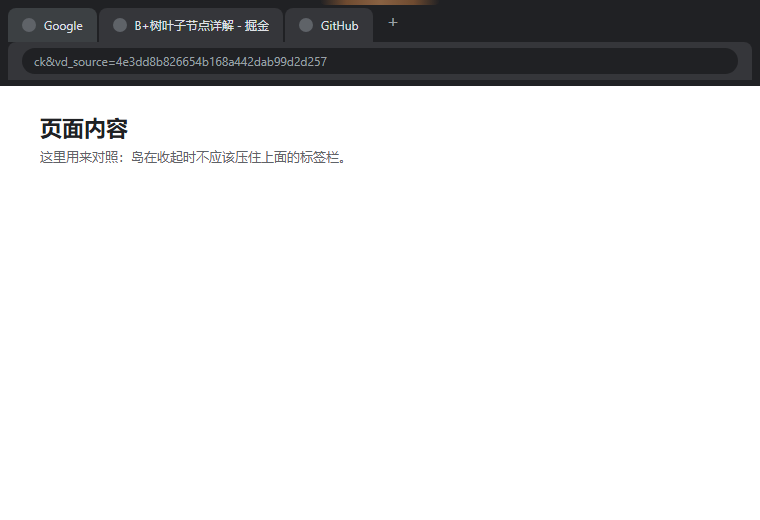

# 桌面灵动岛（DeskIsland）

Windows 顶部居中的小胶囊：记待办、看清单、连续工作到点提醒你起身。

平时它收起成屏幕顶部中央的一条 4px 细线，动键鼠工作时自动让开，停手或切回桌面才自己出现——不会压住浏览器标签栏。



## 特点

- **待办不藏在第二个窗口里**：收起态一行摘要，点开就是清单，回车添加，点圆圈划掉
- **只算你真的在电脑前的时间**：键鼠有输入才累计，离开 3 分钟自动清零，开会回来不会被追着喊起身
- **自动让位**：智能模式下动键鼠就收起，停手 15 秒在当前页面自动出现
- **纯本地**：待办存在 `%APPDATA%\desk-island`，没有任何网络请求

## 目录

```
dynamic-island/              最早的设计原型（单文件网页，四套风格对比）
dynamic-island-app/          应用本体（Electron）
  main.js                    主进程：窗口、显隐状态机、计时、存储
  preload.js                 暴露给页面的安全接口
  src/                       胶囊的 HTML / CSS / 渲染逻辑
  docs/                      各状态预览图
  介绍页.html                可分享的产品介绍页（单文件）
  README.md                  应用详细说明
```

## 跑起来

```bash
cd dynamic-island-app
npm install
npm start
```

打包：

```bash
npm run dist            # 安装版 dist\DeskIsland-1.0.0-setup.exe
npm run dist:portable   # 免安装版 dist\DeskIsland-1.0.0-portable.exe
```

## 显隐状态机

主进程每 60ms 读一次系统光标，维护 `idle / near / over` 三个状态；「可交互」和「可见」是两条独立的时间线，光标一离开胶囊就立刻恢复鼠标穿透。细节见 [dynamic-island-app/README.md](dynamic-island-app/README.md#显隐逻辑为什么不挡标签栏)。

## 许可

MIT
